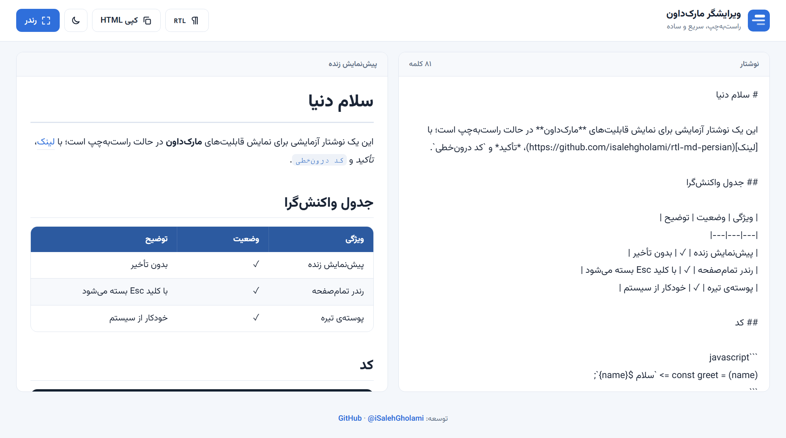
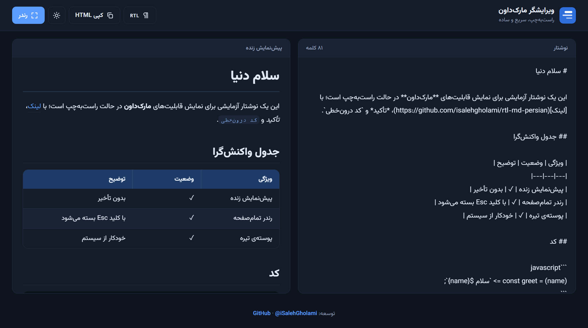

# ویرایشگر مارک‌داون راست‌به‌چپ

مارک‌داون برای متن چپ‌به‌راست ساخته شده. وقتی فارسی توش می‌نویسی، لیست‌ها می‌چسبند به چپ، نقل‌قول‌ها خط کنار را سمت اشتباه می‌گذارند و جدول‌ها هم بیشتر وقت‌ها بیرون از صفحه می‌زنند. این ویرایشگر برای همین نوشته شده: یک صفحه‌ی ساده که فارسی را همان‌طور که باید رندر می‌کند.

**[isalehgholami.github.io/rtl-md-persian](https://isalehgholami.github.io/rtl-md-persian)**





## چه کارهایی می‌کند

- پیش‌نمایش زنده، کنار متن در دسکتاپ و زیر آن در موبایل
- دکمه‌ی **رندر** که خروجی را تمام‌صفحه نشان می‌دهد (با Esc بسته می‌شود)
- فونت [وزیرمتن](https://github.com/rastikerdar/vazirmatn). کد همیشه چپ‌به‌راست می‌ماند.
- جدول‌هایی که در عرض کم، داخل خودشان اسکرول می‌خورند و صفحه را به هم نمی‌ریزند
- تغییر جهت RTL/LTR، پوسته‌ی روشن و تیره و کپی خروجی HTML
- متن خودکار در مرورگر ذخیره می‌شود. بک‌اند و ردیابی ندارد.

## اجرا روی کامپیوتر خودت

سایت استاتیک است و هر سرور فایلی کار می‌کند:

```bash
python -m http.server 8000
```

بعد `http://localhost:8000` را باز کن.

## چند نکته

- اگر وسط یک سلول جدول به `|` نیاز داری، آن را به شکل `\|` بنویس یا داخل بک‌تیک بگذار. وگرنه یک ستون جدید ساخته می‌شود.
- فونت از CDN جیدلیور لود می‌شود. برای کار کاملاً آفلاین، فایل‌های وزیرمتن را کنار پروژه بگذار و `index.html` را به آن‌ها وصل کن.

## مشارکت

ایراد دیدی یا ایده‌ای داری؟ یک Issue یا Pull Request باز کن، خوشحال می‌شوم.

## سازنده

[@iSalehGholami](https://github.com/iSalehGholami). الهام‌گرفته از [dariubs/rtlmd](https://github.com/dariubs/rtlmd). پارس مارک‌داون با [marked](https://github.com/markedjs/marked).

## لایسنس

[MIT](license)
